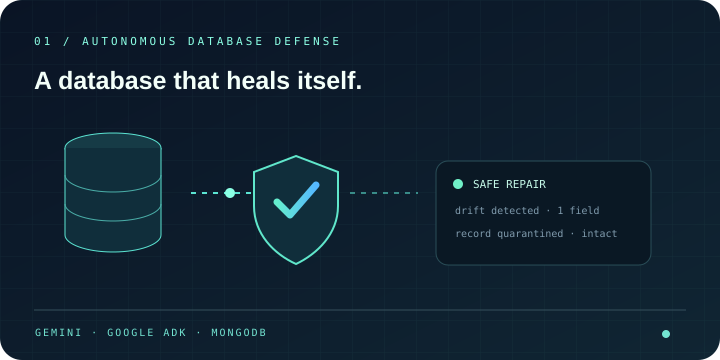
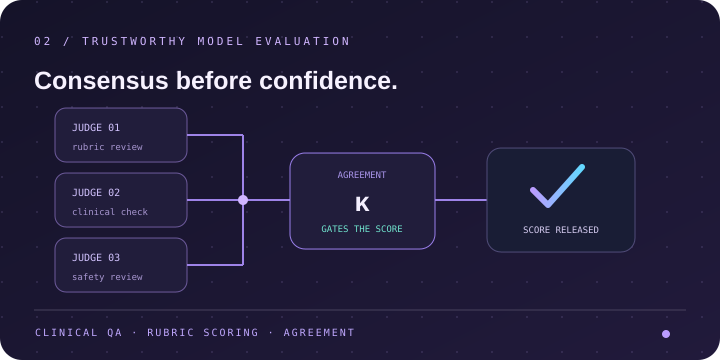
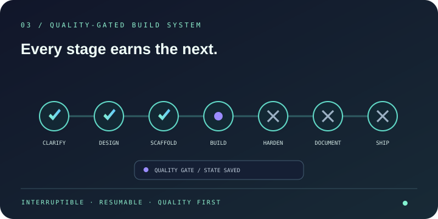
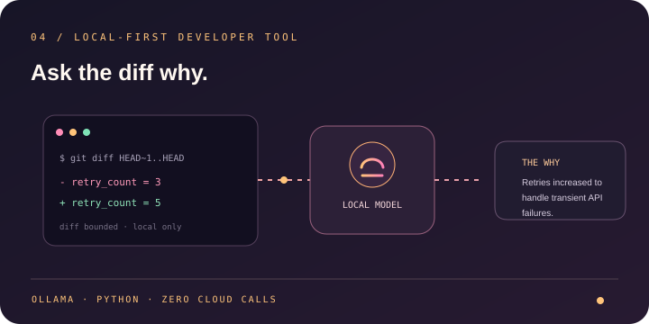
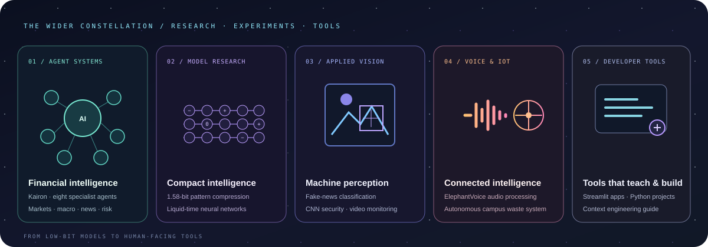
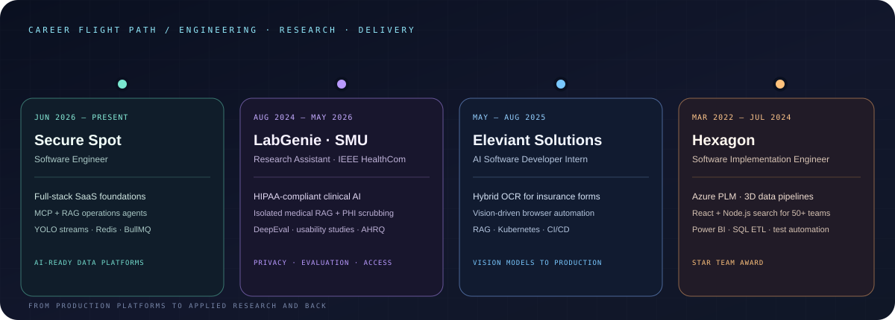

 

<a href="https://github.com/mmm-byte?tab=repositories">PROJECTS</a>　·　<a href="https://www.linkedin.com/in/mahindra-guptha-kotha/">LINKEDIN</a>　·　<a href="mailto:mahikotha22@gmail.com">CONTACT</a>

 

### SELECTED WORK

AI/ML systems, full-stack products, and tools built to work in the real world.

 

 <strong><a href="https://github.com/mmm-byte/SENTINEL">SENTINEL ↗</a></strong> 
Autonomous database defense. Detect drift, contain risk, heal safely.

 

 <strong><a href="https://github.com/mmm-byte/Multi_LLM_Medical_AI_Judge">MEDICAL AI JUDGE ↗</a></strong> 
Clinical QA · inter-judge agreement gates scoring · HIPAA-aware workflows.

 

 <strong><a href="https://github.com/mmm-byte/vibeforge">VIBEFORGE ↗</a></strong> 
A resumable build pipeline where every stage earns the next.

 

 <strong><a href="https://github.com/mmm-byte/git-why">GIT-WHY ↗</a></strong> 
Local AI explains the intent behind a code change, not just the diff.

 

FINANCIAL AGENTS　<a href="https://github.com/mmm-byte/kairon">Kairon</a> 
MODEL RESEARCH　<a href="https://github.com/mmm-byte/bitnet-1.58-pattern-compression">1.58-bit compression</a> · <a href="https://github.com/mmm-byte/Liquid_time_constant_network">Liquid-time networks</a> 
APPLIED ML　<a href="https://github.com/mmm-byte/Fake_News_detection_with_Python">Fake news detection</a> · <a href="https://github.com/mmm-byte/Securing_data_using_CNN">CNN data security</a> · <a href="https://github.com/mmm-byte/CNN_Video_Surveillance">Video surveillance</a> 
VOICE &amp; APPS　<a href="https://github.com/mmm-byte/ElephantVoice">ElephantVoice</a> · <a href="https://github.com/mmm-byte/Streamlits_Projects">Streamlit projects</a> · <a href="https://github.com/mmm-byte/PythonProjects">Python projects</a> 
GUIDES &amp; IOT　<a href="https://github.com/mmm-byte/context-engineering-guide">Context engineering guide</a> · <a href="https://github.com/mmm-byte/An_Intelligent_Garbage_Automation_System">Autonomous campus system</a>

 

 

### THE TOOLKIT

AI/ML engineering　·　LLM systems　·　Agent architecture　·　Evaluation & safety　·　Full-stack development　·　Cloud platforms

  

    

    

Hugging Face · Ollama · Jupyter · Next.js · Node.js · PostgreSQL · Redis · Terraform · GitHub Actions · Arize Phoenix · OpenTelemetry · Dynatrace
 YOLO · OpenCV · DeepEval · Pinecone · Milvus · Snowflake · Socket.IO · Playwright · Postman · Selenium · MATLAB · Raspberry Pi · Angular · Electron · Tailwind · BullMQ

 

### CLOUD &amp; ENTERPRISE

<a href="https://www.credly.com/badges/06c856cd-a642-413d-8287-384f5844c135">Google Cloud Professional Data Engineer ↗</a>　·　<a href="https://github.com/mmm-byte/Cloud_Computing_AWS">AWS portfolio</a>　·　<a href="https://github.com/mmm-byte/Cloud_Computing_Azure">Azure portfolio</a> 
<a href="https://github.com/mmm-byte/Cloud_Computing_AWS">AWS portfolio</a>　8 labs · Terraform · multi-region failover · containerized services 
<a href="https://github.com/mmm-byte/Cloud_Computing_Azure">Azure portfolio</a>　6 labs · Terraform · monitoring · deployment and rollback automation 

  

### FULL-STACK PRODUCTS

<a href="https://github.com/mmm-byte/frontdash">FrontDash · restaurant ordering platform</a>　·　<a href="https://frontdash-iota.vercel.app/">Live app ↗</a>　React · Spring Boot · MySQL 
<a href="https://github.com/mmm-byte/Hotel-discovery-frontend">Hotel discovery</a>　React · search, filters, hotel details, and room availability 
<a href="https://github.com/mmm-byte/verita-ai">Trello workflow prototype</a>　Next.js · TypeScript · drag and drop · persistent board data 

  

### AI/ML &amp; FULL-STACK · LIVE

<strong>AI/ML</strong>　<a href="https://langchain-rag-trubrics-langsmith.vercel.app">RAG chat with feedback ↗</a>　·　<a href="https://chatbot-template.streamlit.app/">Chatbot ↗</a>　·　<a href="https://st-gsheets.streamlit.app/">Google Sheets connector ↗</a> 
<strong>FULL-STACK</strong>　<a href="https://frontdash-iota.vercel.app/">FrontDash · live Vercel app ↗</a>　React · Spring Boot · MySQL 

  

### PUBLICATIONS &amp; EDUCATION

<strong>Springer</strong>　Autonomous Campus Garbage Management System · <em>Advanced Engineering Optimization Through Intelligent Techniques</em> 
<strong>IEEE HealthCom</strong>　Clinical AI usability and patient outcomes 
<strong>M.S. Computer Science, AI/ML</strong>　Southern Methodist University　·　<strong>B.Tech Mechanical Engineering</strong>　R.V.R. &amp; J.C. College of Engineering · Full Academic Scholar

  

### CERTIFICATIONS

<a href="https://www.credly.com/badges/06c856cd-a642-413d-8287-384f5844c135">Google Cloud Professional Data Engineer ↗</a> 
IBM · Cybersecurity Tools and Cyber Attacks (2023)　·　Microsoft Azure Fundamentals · Udemy (2023)

 

M.S. Computer Science · AI/ML · Southern Methodist University · Dallas, TX

  

<a href="mailto:mahikotha22@gmail.com"><strong>Have a system worth building? Let’s talk ↗</strong></a>

  

CODE THAT THINKS　·　INFRASTRUCTURE THAT SCALES　·　DATA THAT’S SAFE

