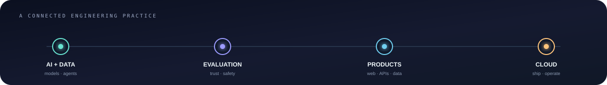
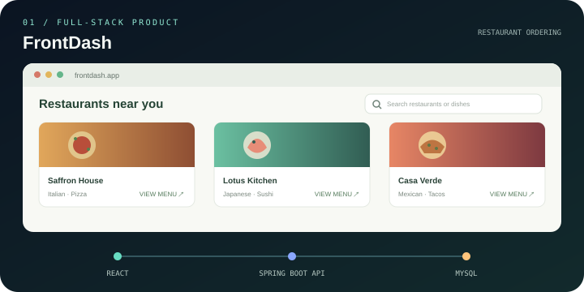
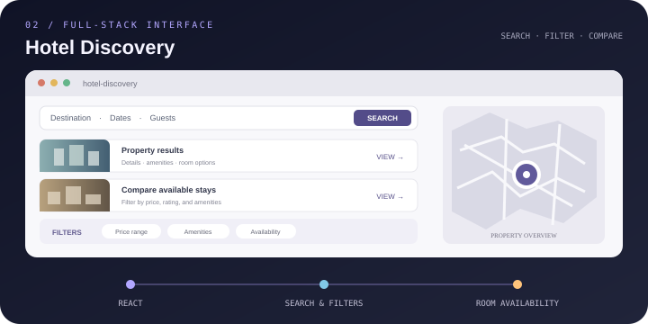

 

<a href="https://github.com/mmm-byte?tab=repositories">PROJECTS</a>　·　<a href="https://www.linkedin.com/in/mahindra-guptha-kotha/">LINKEDIN</a>　·　<a href="mailto:mahikotha22@gmail.com">CONTACT</a>

 

 

### SELECTED WORK

From model research and evaluation to applications people can use.

 

<table>
<tr>
<td align="center" valign="top" width="50%">

<h3><a href="https://github.com/mmm-byte/frontdash">FrontDash</a></h3>

<a href="https://frontdash-iota.vercel.app/">LIVE APP ↗</a>　·　<a href="https://github.com/mmm-byte/frontdash">SOURCE ↗</a>

Full-stack restaurant ordering · React · Spring Boot · MySQL · Vercel
</td>
<td align="center" valign="top" width="50%">

<h3><a href="https://github.com/mmm-byte/Hotel-discovery-frontend">Hotel Discovery</a></h3>

<a href="https://hotel-discovery-frontend.vercel.app/">LIVE APP ↗</a>　·　<a href="https://github.com/mmm-byte/Hotel-discovery-frontend">SOURCE ↗</a>

Hotel search · filters · property details · room availability
</td>
</tr>
<tr>
<td align="center" valign="top" width="50%">

<h3><a href="https://github.com/mmm-byte/SENTINEL">SENTINEL</a></h3>

<a href="https://github.com/mmm-byte/SENTINEL">VIEW REPOSITORY ↗</a>

Autonomous database defense · detect drift · contain risk · repair safely
</td>
<td align="center" valign="top" width="50%">

<h3><a href="https://github.com/mmm-byte/Multi_LLM_Medical_AI_Judge">Medical AI Judge</a></h3>

<a href="https://github.com/mmm-byte/Multi_LLM_Medical_AI_Judge">VIEW REPOSITORY ↗</a>

Clinical AI evaluation · model agreement · privacy-aware RAG workflows
</td>
</tr>
<tr>
<td align="center" valign="top" width="50%">

<h3><a href="https://github.com/mmm-byte/vibeforge">vibeforge</a></h3>

<a href="https://github.com/mmm-byte/vibeforge">VIEW REPOSITORY ↗</a>

Resumable AI build pipeline · quality gates from idea to delivery
</td>
<td align="center" valign="top" width="50%">

<h3><a href="https://github.com/mmm-byte/git-why">git-why</a></h3>

<a href="https://github.com/mmm-byte/git-why">VIEW REPOSITORY ↗</a>

Local-first AI · explain the intent behind a code change
</td>
</tr>
</table>

 

<strong>AI/ML LIVE DEMOS</strong>　<a href="https://langchain-rag-trubrics-langsmith.vercel.app">RAG chat + feedback ↗</a>　·　<a href="https://st-gsheets.streamlit.app/">Google Sheets connector ↗</a>　·　<a href="https://chatbot-template.streamlit.app/">Chatbot ↗</a>

 

### MORE PROJECTS · RESEARCH · TOOLS

<strong>AGENTS</strong>　<a href="https://github.com/mmm-byte/kairon">Kairon financial agents</a>　·　<a href="https://github.com/mmm-byte/context-engineering-guide">Context engineering guide</a> 
<strong>MODEL RESEARCH</strong>　<a href="https://github.com/mmm-byte/bitnet-1.58-pattern-compression">1.58-bit compression</a>　·　<a href="https://github.com/mmm-byte/Liquid_time_constant_network">Liquid-time networks</a> 
<strong>APPLIED ML</strong>　<a href="https://github.com/mmm-byte/Fake_News_detection_with_Python">Fake news detection</a>　·　<a href="https://github.com/mmm-byte/Securing_data_using_CNN">CNN data security</a>　·　<a href="https://github.com/mmm-byte/CNN_Video_Surveillance">Video surveillance</a> 
<strong>VOICE · APPS · IOT</strong>　<a href="https://github.com/mmm-byte/ElephantVoice">ElephantVoice</a>　·　<a href="https://github.com/mmm-byte/Streamlits_Projects">Streamlit apps</a>　·　<a href="https://github.com/mmm-byte/An_Intelligent_Garbage_Automation_System">Autonomous campus system</a>

 

### EXPERIENCE · RESEARCH · DELIVERY

 

### ENGINEERING TOOLKIT

<strong>AI / ML</strong>　Python · PyTorch · Hugging Face · LangChain · RAG · model evaluation · YOLO · OpenCV 
<strong>FULL-STACK</strong>　React · Next.js · TypeScript · Node.js · Spring Boot · FastAPI · REST APIs · SQL 
<strong>PLATFORMS</strong>　Google Cloud · AWS · Azure · Docker · Kubernetes · Terraform · Redis · PostgreSQL · CI/CD 
<strong>QUALITY &amp; OPERATIONS</strong>　DeepEval · Playwright · GitHub Actions · OpenTelemetry · Arize Phoenix · Dynatrace

  

     

 

<table>
<tr>
<td align="center" valign="top" width="50%">

### CLOUD &amp; CERTIFICATION

<a href="https://www.credly.com/badges/06c856cd-a642-413d-8287-384f5844c135">Google Cloud Professional Data Engineer ↗</a> 
<a href="https://github.com/mmm-byte/Cloud_Computing_AWS">AWS cloud portfolio</a> · 8 labs · Terraform · multi-region failover 
<a href="https://github.com/mmm-byte/Cloud_Computing_Azure">Azure cloud portfolio</a> · 6 labs · monitoring · deployment automation
 IBM · Cybersecurity Tools and Cyber Attacks (2023) · Microsoft Azure Fundamentals (2023)

</td>
<td align="center" valign="top" width="50%">

### EDUCATION &amp; PUBLICATIONS

<strong>M.S. Computer Science · AI/ML</strong> Southern Methodist University 
<strong>B.Tech Mechanical Engineering</strong> R.V.R. &amp; J.C. College of Engineering · Full Academic Scholar 
Springer · Autonomous Campus Garbage Management System 
IEEE HealthCom · Clinical AI usability and patient outcomes

</td>
</tr>
</table>

 

AI/ML ENGINEERING　·　FULL-STACK PRODUCTS　·　CLOUD SYSTEMS

  

<a href="mailto:mahikotha22@gmail.com"><strong>Have a system worth building? Let’s talk ↗</strong></a>

  

<a href="https://www.linkedin.com/in/mahindra-guptha-kotha/">LINKEDIN</a>　·　<a href="https://github.com/mmm-byte?tab=repositories">ALL REPOSITORIES</a>

